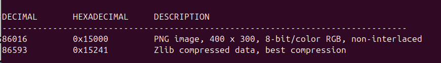
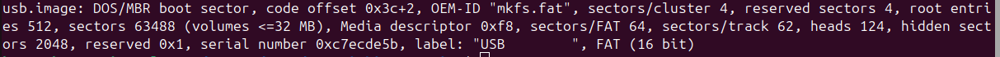

# CTF : Fichier Supprimé

### Avant-propos 
Conformément aux bonnes pratiques des CTF, le flag final est masqué. 

### Description 

**Objectif :** Retrouver un fichier supprimé sur une clé USB. 
**Fichier fourni :** ch39.gz

**Auteur :** Manah  
**Plateforme :** Root Me

**Type :** Forensic

## Résolution 

1. Premièrement, nous identifions le type de fichier avec la commande suivante. Le fichier s'avère être un gzip compressé. 

```bash 
file ch39.gz
```

2. Décompression via `gunzip` et inspection de l'image disque :

```bash 
gunzip ch39.gz
binwalk usb.image
```


Le fichier compressé contenait une image disque et un fichier binaire : `usb.image` et `ch39` 

Après la commande suivante nous découvrons qu'il s'agit d'une image de filesystem FAT :

```bash 
file usb.image
```


3. Montage de l'image : 
```bash 
sudo mount -o loop usb.image /tmp/usb
ls -la /tmp/usb
```

Le dossier se trouvait être vide et indiquait qu'un fichier avait probablement été supprimé (de plus le nom du CTF est littéralement "Fichier Supprimé"). 
Or sur FAT, un fichier supprimé reste récupérable tant qu'il n'est pas écrasé. 

4. Récupération du fichier : 
```bash 
sudo testdisk usb.image
```

Puis dans l'interface nous suivons les étapes suivantes : 
- Proceed
- None (car il n'y a pas de table de partition dans notre cas)
- Undelete (pour récupérer le fichier supprimé)
- c ("copy" pour copier le fichier supprimé dans un repértoire)

5. Inspection des métadonnées de l'image png récupérée 

```bash 
exiftool anonymous.png
```

**Résultat :** 

En inspectant les métadonnées de l'image, nous trouvons le créateur qui correspond au flag. Le flag s'écrit sous la forme `prenom_nom`. 