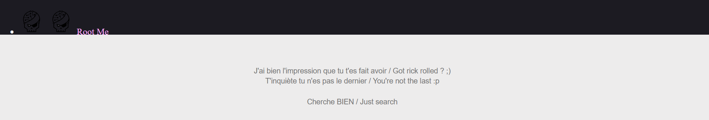
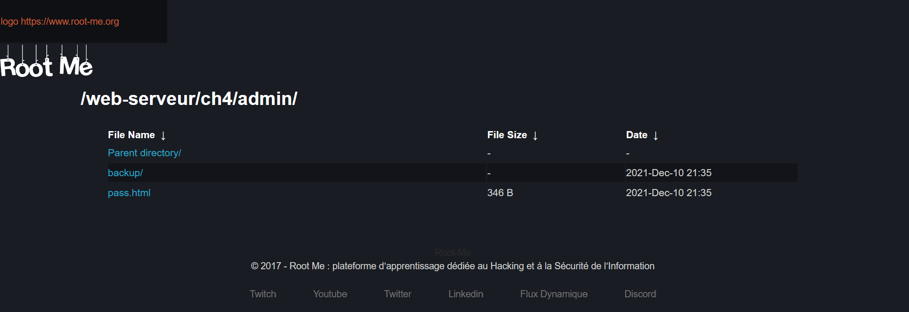
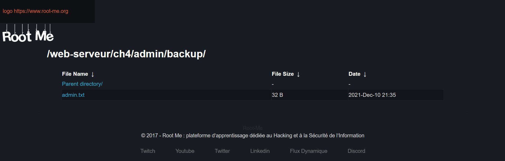

# Write-up - Root-Me : HTTP Indexing

|  |  |
| --- | --- |
| Plateforme | Root-Me |
| Catégorie | Web - Serveur |
| Challenge | ch4 |
| Cible | http://challenge01.root-me.org/web-serveur/ch4/ |
| Outils | Navigateur + inspecteur (DevTools) |
| Date | 25/11/2026 |

## Enoncé

La page d'accueil du challenge est quasiment vide : seul un iframe d'en-tête Root-Me s'affiche. Il n'y a pas de formulaire ni de contenu visible.   
Il n'y a aucune indication textuelle qui oriente la recherche : passer par l'inspection du code source a été nécessaire.

## Reconnaissance

L'inspection du DOM via les DevTools révèle, dans le `<body>`, un commentaire HTML laissé par le développeur :

```html
<!--include("admin/pass.html")-->
```

Ce commentaire n'est pas interprété côté serveur (c'est juste du texte commenté en HTML), mais il révèle l'existence d'un chemin `admin/pass.html` normalement caché à l'utilisateur.   
C'est une fuite d'information classique : un reste de logique de développement (ou un faux indice volontairement laissé) qui expose l'arborescence interne du serveur.

## Exploitation

1. **Navigation** vers `http://challenge01.root-me.org/web-serveur/ch4/admin/pass.html`.
La page affiche un message moqueur : c'est un leurre volontaire du créateur du challenge, pas le fichier recherché.


2. **Remonter d'un niveau** : navigation vers le répertoire parent `http://challenge01.root-me.org/web-serveur/ch4/admin/`.   
Le **listing de répertoire est activé** (misconfiguration) : il affiche le contenu brut du dossier, révélant deux entrées — `pass.html` (le leurre, 346 B) et un sous-dossier **`backup/`** non référencé ailleurs.


3. **Suivre le dossier backup/** : `http://challenge01.root-me.org/web-serveur/ch4/admin/backup/`. Le listing de répertoire y est également activé et expose un fichier `admin.txt` (32 B).


4. **Lire le fichier** : `http://challenge01.root-me.org/web-serveur/ch4/admin/backup/admin.txt` affiche directement son contenu en texte brut.

## Résultat

Le fichier `admin.txt` contient directement la réponse attendue :

```
Password / Mot de passe : XXXXX
```

**Mot de passe :** `XXXX`

## Analyse et remédiation

Deux faiblesses combinées, toutes deux rattachées à **A02 - Security Misconfiguration** (OWASP Top 10) :

1. **Fuite d'information par commentaire HTML** : un reste de code/commentaire révèle un chemin interne non destiné au public.

2. **Listing de répertoire activé** (`Options +Indexes` sous Apache, ou équivalent) sur des dossiers sans page d'index : n'importe qui peut lister le contenu d'`admin/` et `admin/backup/` sans authentification, et tomber sur un fichier de sauvegarde (`admin.txt`) qui n'aurait jamais dû être accessible publiquement.

**Remédiations :**

- Désactiver le listing de répertoire par défaut (`Options -Indexes` sous Apache, directive équivalente sous nginx) sur l'ensemble du site ;
- Ne jamais laisser de commentaires révélant la structure interne dans le code livré en production ;
- Ne jamais stocker de fichiers de sauvegarde ou de données sensibles dans un répertoire accessible depuis le webroot, même « caché » par absence de lien direct (sécurité par l'obscurité ≠ sécurité).
